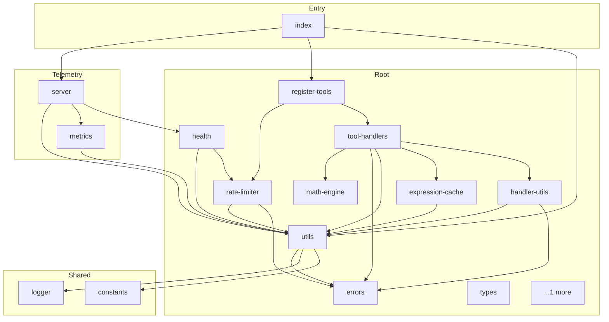

<!-- repo-map:no-verification -->
<!-- GENERATED FILE -- do not edit by hand.
     Regenerate with `repo-tools map`. -->

# @danielsimonjr/math-mcp - Dependency Graph

**Version**: 4.3.1

This document provides a comprehensive dependency graph of all files, components, imports, functions, and variables in the codebase.

---

## Table of Contents

1. [Overview](#overview)
2. [Package Dependencies](#package-dependencies)
3. [Root Dependencies](#root-dependencies)
4. [Entry Dependencies](#entry-dependencies)
5. [Shared Dependencies](#shared-dependencies)
6. [Telemetry Dependencies](#telemetry-dependencies)
7. [Dependency Matrix](#dependency-matrix)
8. [Circular Dependency Analysis](#circular-dependency-analysis)
9. [Visual Dependency Graph](#visual-dependency-graph)
10. [Summary Statistics](#summary-statistics)

---

<a id="overview"></a>
## Overview

The codebase is organized into the following modules:

- **root**: 11 files
- **entry**: 1 file
- **shared**: 2 files
- **telemetry**: 2 files

---

<a id="root-dependencies"></a>

## Root Dependencies

### `src/errors.ts` - This module defines specialized error classes to categorize different types

**Exports:**
- Classes: `MathMCPError`, `ValidationError`, `TimeoutError`, `SizeLimitError`, `ComplexityError`, `RateLimitError`

---

### `src/expression-cache.ts` - Caches compiled expressions to avoid repeated parsing overhead.

**Internal Dependencies:**
| File | Imports | Type |
|------|---------|------|
| `./utils.js` | `logger` | Import |

**Exports:**
- Classes: `LRUCache`
- Functions: `generateCacheKey`, `getCachedExpression`, `getCacheStats`
- Constants: `expressionCache`

---

### `src/handler-utils.ts` - handler-utils module

**External Dependencies:**
| Package | Import |
|---------|--------|
| `@modelcontextprotocol/server` | `CallToolResult` |

**Internal Dependencies:**
| File | Imports | Type |
|------|---------|------|
| `./utils.js` | `logger, perfTracker` | Import |
| `./errors.js` | `MathMCPError` | Import |

**Exports:**
- Interfaces: `HandlerOptions`
- Types: `ToolResponse`
- Functions: `successResponse`, `errorResponse`, `executeHandler`, `withErrorHandling`

---

### `src/health.ts` - Provides:

**Internal Dependencies:**
| File | Imports | Type |
|------|---------|------|
| `./utils.js` | `logger` | Import |
| `./rate-limiter.js` | `globalRateLimiter` | Import |

**Exports:**
- Interfaces: `HealthCheck`, `HealthResponse`
- Types: `HealthStatus`, `CheckStatus`
- Functions: `getHealthStatus`, `getLiveness`, `getReadiness`

---

### `src/math-engine.ts` - `@danielsimonjr/mathts-compat` exposes `create(all)` to build a

**External Dependencies:**
| Package | Import |
|---------|--------|
| `@danielsimonjr/mathts-compat` | `create, all, MathInstance` |

**Exports:**
- Default: `default`

---

### `src/rate-limiter.ts` - Implements protection against DoS attacks:

**Internal Dependencies:**
| File | Imports | Type |
|------|---------|------|
| `./utils.js` | `logger` | Import |
| `./errors.js` | `RateLimitError` | Import |

**Exports:**
- Classes: `RateLimiter`
- Interfaces: `RateLimiterConfig`
- Functions: `withRateLimit`
- Constants: `globalRateLimiter`

---

### `src/register-tools.ts` - register-tools module

**External Dependencies:**
| Package | Import |
|---------|--------|
| `@modelcontextprotocol/server` | `CallToolResult, McpServer` |
| `zod/v4` | `*` |

**Internal Dependencies:**
| File | Imports | Type |
|------|---------|------|
| `./rate-limiter.js` | `globalRateLimiter, withRateLimit` | Import |
| `./tool-handlers.js` | `handleEvaluate, handleSimplify, handleDerivative, handleSolve, handleMatrixOperations, handleStatistics, handleUnitConversion, withErrorHandling` | Import |

**Exports:**
- Functions: `registerMathTools`

---

### `src/tool-handlers.ts` - Each handler validates inputs, executes with timeout protection,

**Internal Dependencies:**
| File | Imports | Type |
|------|---------|------|
| `./math-engine.js` | `default` | Import |
| `./validation.js` | `validateExpression, validateScope, validateVariableName, validateMatrix, validateSquareMatrix, validateMatrixSize, validateMatrixCompatibility, validateNumberArray, validateArrayLength, validateEnum, safeJsonParse` | Import |
| `./errors.js` | `ValidationError` | Import |
| `./utils.js` | `withTimeout, DEFAULT_OPERATION_TIMEOUT` | Import |
| `./expression-cache.js` | `getCachedExpression` | Import |
| `./handler-utils.js` | `executeHandler, successResponse, ToolResponse` | Import |
| `./handler-utils.js` | `ToolResponse, withErrorHandling` | Re-export |

**Exports:**
- Functions: `handleEvaluate`, `handleSimplify`, `handleDerivative`, `handleSolve`, `handleMatrixOperations`, `handleStatistics`, `handleUnitConversion`
- Re-exports: `ToolResponse`, `withErrorHandling`

---

### `src/types.ts` - Holds interfaces that need to be referenced from multiple layers

---

### `src/utils.ts` - This module provides common utility functions including:

**Internal Dependencies:**
| File | Imports | Type |
|------|---------|------|
| `./errors.js` | `TimeoutError` | Import |
| `./shared/logger.js` | `logger` | Import |
| `./shared/constants.js` | `DEFAULT_OPERATION_TIMEOUT` | Import |
| `./shared/logger.js` | `logger` | Re-export |
| `./shared/logger.js` | `LogLevel` | Re-export |

**Exports:**
- Functions: `withTimeout`, `getPackageVersion`, `formatNumber`, `isPlainObject`
- Constants: `DEFAULT_OPERATION_TIMEOUT`, `perfTracker`
- Re-exports: `logger`, `LogLevel`

---

### `src/validation.ts` - This module provides comprehensive validation functions to ensure all user inputs

**Internal Dependencies:**
| File | Imports | Type |
|------|---------|------|
| `./errors.js` | `ValidationError, SizeLimitError, ComplexityError` | Import |

**Exports:**
- Functions:

  ```text
  safeJsonParse, validateMatrix, validateSquareMatrix, validateMatrixSize,
  validateMatrixCompatibility, validateNumberArray, validateArrayLength, validateExpression,
  validateVariableName, validateScope, validateEnum
  ```

- Constants: `LIMITS`

---

<a id="entry-dependencies"></a>

## Entry Dependencies

### `src/index.ts` - This is the main entry point for the Math MCP Server (entry `src/index.ts`,

**External Dependencies:**
| Package | Import |
|---------|--------|
| `@modelcontextprotocol/server` | `McpServer` |
| `@modelcontextprotocol/server/stdio` | `serveStdio` |

**Internal Dependencies:**
| File | Imports | Type |
|------|---------|------|
| `./telemetry/server.js` | `startTelemetryServer, stopTelemetryServer` | Import |
| `./register-tools.js` | `registerMathTools` | Import |
| `./utils.js` | `logger, getPackageVersion, perfTracker` | Import |

---

<a id="shared-dependencies"></a>

## Shared Dependencies

### `src/shared/constants.ts` - No dependencies)

**Exports:**
- Constants: `DEFAULT_OPERATION_TIMEOUT`, `PERF_TRACKING_ENABLED`, `PERF_LOGGING_ENABLED`

---

### `src/shared/logger.ts` - No dependencies)

**Exports:**
- Enums: `LogLevel`
- Constants: `logger`

---

<a id="telemetry-dependencies"></a>

## Telemetry Dependencies

### `src/telemetry/metrics.ts` - Provides:

**External Dependencies:**
| Package | Import |
|---------|--------|
| `prom-client` | `*` |

**Internal Dependencies:**
| File | Imports | Type |
|------|---------|------|
| `../utils.js` | `logger` | Import |

**Exports:**
- Functions: `recordOperation`, `recordError`, `recordCacheOperation`, `recordRateLimitHit`, `recordInputSize`, `getMetrics`, `getMetricsJSON`, `resetMetrics`
- Constants:

  ```text
  register, operationDuration, operationCount, rateLimitHits, rateLimitQueue, cacheOperations,
  cacheSize, errorCount, inputSize, activeConnections, mcpRequests
  ```


---

### `src/telemetry/server.ts` - Provides:

**Node.js Built-in Dependencies:**
| Module | Import |
|--------|--------|
| `http` | `createServer, IncomingMessage, ServerResponse` |

**Internal Dependencies:**
| File | Imports | Type |
|------|---------|------|
| `../utils.js` | `logger` | Import |
| `./metrics.js` | `getMetrics` | Import |
| `../health.js` | `getHealthStatus, getLiveness, getReadiness` | Import |

**Exports:**
- Classes: `TelemetryServer`
- Interfaces: `TelemetryServerConfig`
- Functions: `startTelemetryServer`, `stopTelemetryServer`, `getTelemetryServer`

---

<a id="dependency-matrix"></a>
## Dependency Matrix

### File Import/Export Matrix

| File | Imports From | Exports To |
|------|--------------|------------|
| `src/utils` | 3 files | 8 files |
| `src/tool-handlers` | 6 files | 1 file |
| `src/errors` | 0 files | 5 files |
| `src/rate-limiter` | 2 files | 2 files |
| `src/telemetry/server` | 3 files | 1 file |
| `src/handler-utils` | 2 files | 1 file |
| `src/health` | 2 files | 1 file |
| `src/index` | 3 files | 0 files |
| `src/register-tools` | 2 files | 1 file |
| `src/expression-cache` | 1 file | 1 file |
| `src/telemetry/metrics` | 1 file | 1 file |
| `src/validation` | 1 file | 1 file |
| `src/math-engine` | 0 files | 1 file |
| `src/shared/constants` | 0 files | 1 file |
| `src/shared/logger` | 0 files | 1 file |
| `src/types` | 0 files | 0 files |

---

<a id="circular-dependency-analysis"></a>
## Circular Dependency Analysis

**No circular dependencies detected.**
---

<a id="visual-dependency-graph"></a>
## Visual Dependency Graph



---

<a id="summary-statistics"></a>
## Summary Statistics

| Category | Count |
|----------|-------|
| Total Source Files | 39 |
| Subsystems | 4 |
| Total Lines of Code | 10848 |
| Total Exports | 89 |
| Total Re-exports | 4 |
| Total Classes | 9 |
| Total Interfaces | 5 |
| Total Functions | 47 |
| Total Type Guards | 1 |
| Total Enums | 1 |
| Type-only Imports | 0 |
| Runtime Cyclic Components | 0 |
| Type-only Cyclic Components | 0 |
| Files in Runtime Cycles | 0 |
| Files in Type-only Cycles | 0 |

---

*Version*: 4.3.1
